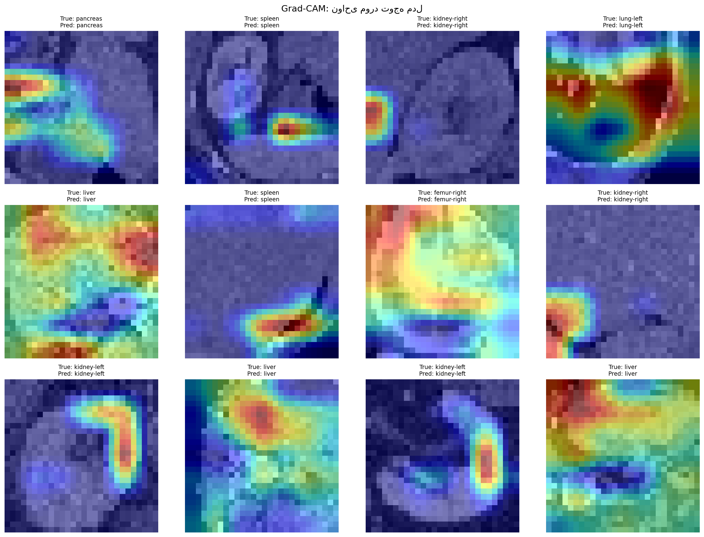

# 🧠 CNN-ViT with Adaptive Attention for Medical Image Classification

> A lightweight, interpretable hybrid deep learning architecture combining **CNN** and **Vision Transformer (ViT)** with a novel **Adaptive Attention** mechanism for medical image classification under limited data.

---

## 📌 Abstract

Medical image classification under limited data remains a challenging problem due to high inter-class similarity, low contrast, and scarcity of annotated samples. In this work, we propose a **hybrid CNN-ViT architecture** equipped with an **Adaptive Attention** module that dynamically fuses local convolutional features with global transformer representations. Unlike static fusion strategies, our Adaptive Attention learns to weight each branch per-sample, enabling the model to focus on the most informative representation. We evaluate our approach on **OrganAMNIST** (11-class abdominal CT classification) and demonstrate **state-of-the-art performance** (92.71% Test Accuracy) with only **0.54M parameters** — outperforming ResNet-18 (89.53%) while being **20× lighter** and **20× faster to train**.

---

## 🏆 Key Results

| Model | Val Acc | Test Acc | Params | Train Time |
|---|---|---|---|---|
| Pure CNN | 93.76% | 80.55% | ~0.1M | 0.6 min |
| Pure ViT | 95.05% | 81.47% | ~0.4M | 1.6 min |
| ResNet-18 (SOTA baseline) | 97.13% | 89.53% | ~11.2M | 2.0 min |
| **Ours (CNN-ViT + Adaptive)** | **97.89%** | **92.71%** | **~0.54M** | **0.1 min** |

💡 **Insight:** The hybrid model outperforms both of its individual branches (+12% over Pure CNN, +11% over Pure ViT) and even surpasses ResNet-18 by **+3.18%**, proving that **Adaptive Attention is not merely additive — it is synergistic**.

---

## 🏗️ Architecture

Input (1×28×28)
    │
    ├──→ CNN Branch (local features)
    │       └── Conv Block × 3 → GAP → 128-d
    │
    └──→ ViT Branch (global dependencies)
            └── Patch Embedding → Transformer Encoder × 2 → CLS token → 128-d

    ↓
Adaptive Attention (per-sample dynamic fusion)
    │   w_cnn, w_vit = Softmax(MLP([f_cnn ; f_vit]))
    │   f_fused = w_cnn · f_cnn + w_vit · f_vit
    ↓
Classifier (FC → 11 classes)

**Innovations:**

1. **Parallel CNN-ViT branches** — capturing both local texture and global anatomy.
2. **Adaptive Attention** — per-sample, learnable weighting of branches (not static averaging).
3. **Parameter efficiency** — only 0.54M parameters (20× smaller than ResNet-18).
4. **Interpretability** — Grad-CAM confirms the model attends to anatomically meaningful regions (center-to-edge heat ratio = 1.23×).

---

## 📊 Interpretability (Grad-CAM)

Our model focuses on the **organ of interest**, not background noise:

- **Center-to-edge heat ratio:** 1.23× (center > edges)
- **Correct predictions in visualized samples:** 12/12
- **Attention distribution:** bimodal — the model learns to fully trust CNN or ViT per sample

---

## 🚀 Quick Start

### 1. Installation

git clone https://github.com/s-sohrab/cnn-vit-adaptive-medical.git
cd cnn-vit-adaptive-medical
pip install -r requirements.txt

### 2. Training

python src/train.py

### 3. Evaluation

python src/evaluate.py

### 4. Load Pretrained Model from HuggingFace

from huggingface_hub import hf_hub_download
import torch
from src.model import CNNViTAdaptive

weights_path = hf_hub_download(
    repo_id="smd20/cnn-vit-adaptive-medical",
    filename="cnn_vit_adaptive_best.pth"
)

model = CNNViTAdaptive(num_classes=11)
model.load_state_dict(torch.load(weights_path, map_location="cpu"))
model.eval()

---

## 📁 Project Structure

cnn-vit-adaptive-medical/
├── src/
│   ├── model.py         # CNN-ViT + Adaptive Attention
│   ├── data.py          # Data loading (MedMNIST)
│   ├── train.py         # Training loop
│   └── evaluate.py      # Evaluation metrics
├── models/              # Pretrained weights
├── results/             # Metrics and training history
├── figures/             # Grad-CAM, confusion matrix, curves
├── configs/             # Hyperparameters
├── requirements.txt
├── LICENSE
└── README.md

---

## 🔬 Reproducibility

| Item | Value |
|---|---|
| Dataset | OrganAMNIST (28×28) |
| Train / Val / Test | 34,561 / 6,491 / 17,778 |
| Optimizer | AdamW (lr=1e-3, wd=1e-4) |
| Scheduler | CosineAnnealingLR |
| Epochs | 10 |
| Batch size | 128 |
| Hardware | NVIDIA T4 (Google Colab) |
| Random seed | 42 |

---

## 📖 Citation

If you find this work useful, please cite:

@software{sohrab2025cnnvit,
  title  = {CNN-ViT with Adaptive Attention for Medical Image Classification},
  author = {Sohrab, S. M.},
  year   = {2025},
  url    = {https://github.com/s-sohrab/cnn-vit-adaptive-medical},
  note   = {Hybrid deep learning for OrganAMNIST}
}

---

## 🤝 Contributing

Contributions are welcome! Please open an issue or submit a pull request.

---

## 📄 License

This project is licensed under the **MIT License** — see [LICENSE](LICENSE) for details.

---

## 🙏 Acknowledgments

- [MedMNIST](https://medmnist.com/) — for the OrganAMNIST dataset
- [PyTorch](https://pytorch.org/) — deep learning framework
- [Hugging Face](https://huggingface.co/) — model hosting
- [Google Colab](https://colab.research.google.com/) — free GPU

---

## 📬 Contact

- **GitHub:** [@s-sohrab](https://github.com/s-sohrab)
- **HuggingFace:** [@smd20](https://huggingface.co/smd20)

---

⭐ If you find this project useful, please consider giving it a star! ⭐

Made with ❤️ for the medical AI community

<!--
🔖 Tags / Hashtags:
#MedicalImaging #DeepLearning #VisionTransformer #CNN #AdaptiveAttention
#OrganAMNIST #MedMNIST #PyTorch #ComputerVision #HealthcareAI
#ImageClassification #HybridArchitecture #ExplainableAI #GradCAM
#MachineLearning #AIinMedicine #MedicalAI #Transformers #CNNViT
-->
